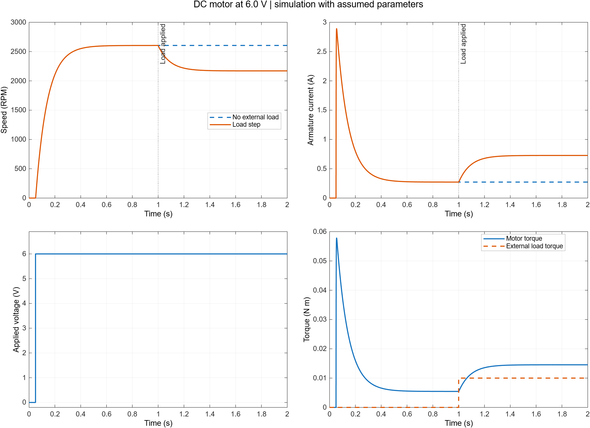

# IoT Nexus MATLAB learning journal

This is the ongoing process record for the simulation stage of IoT Nexus. It records what we attempted, why we made each change, the evidence we saved and the concepts we need to understand. It will provide source material for the GitHub README, portfolio case study and a later blog.

The current plan is simulation first. No hardware purchase is required for this stage. The earlier hardware shopping proposal is historical and is not the active plan.

## How we will maintain this document

For each session add a dated entry containing the question, model or code changed, parameter assumptions, experiment, recorded outputs, checks, explanation, limitations and next step. Preserve earlier results and link the exact run folder. Record failed attempts too. A prediction, a successful simulation and a physical measurement are different kinds of evidence.

Personal reflections belong to the learner. The observation prompts below remain unanswered until the learner responds; prepared explanations do not establish that the learner has mastered a concept. Future sessions should update this journal together with the corresponding code and evidence.

## 17 October 2026  Environment and first model

### The question

Can we build a motor-control portfolio project using professional simulation tools, learn the motor physics again, and preserve enough evidence to explain the work publicly?

### What we established

The user reported MATLAB R2026b with MATLAB, Simulink, Control System Toolbox, Simscape and Simscape Electrical installed, along with additional products. The initial `ver` output establishes installation, not successful execution of every toolbox. No personal licence identifier is retained in this repository.

The user ran a small Constant to Integrator to Scope model. Their screenshot shows a ramp rising from zero to two after two simulated seconds and the success message. That establishes basic Simulink execution in the desktop session.

An earlier attempt to open `vdp` failed because the model file could not be resolved. We did not infer a licence problem from that error. We replaced the dependency on installed examples with a model built from standard blocks.

### The implementation decision

Lesson 01 uses the two differential equations of a linear permanent-magnet DC motor. Explicit resistance, inductance, back-EMF, torque, inertia and friction terms make the calculation inspectable while we relearn the subject. This is an equation-based Simulink model; it has not yet exercised the physical component library in Simscape Electrical.

We chose assumed parameters and labelled them accordingly. We are not fitting a real motor, asserting motor ratings or selecting hardware. Temperature and vibration are outside this model.

### What we built

- `simulation/matlab/lesson01_parameters.m` defines the motor and experiment settings.
- `simulation/matlab/build_lesson01_motor.m` builds and saves an editable `.slx` model without hidden base-workspace parameters.
- `simulation/matlab/run_lesson01.m` compares baseline and load-change experiments and exports CSV, a plot, JSON and a result note. It creates a new folder for every run.
- `docs/matlab/01-motor-basics.md` explains the quantities, equations, predicted equilibrium and how to run the lesson.

### The experiment

Both cases receive 6 V at 0.05 s, starting with zero current and zero speed. The baseline has no external load torque. The loaded case receives an opposing torque of 0.01 N m at 1 s. Each main run lasts two simulated seconds. A third run repeats the loaded case with half the solver step.

We monitor armature current, speed, motor torque, applied voltage, load torque and back EMF. We also calculate electrical input power, winding loss and mechanical power delivered to the external load. These are simulation quantities, not physical sensor readings.

### Recorded results

The reviewed run is `lesson01_20261017_221702_944`, generated locally in MATLAB R2026b. Its portable records are saved in [evidence/lesson01](../../simulation/matlab/evidence/lesson01/RESULTS.md). The full generated run and raw workspace recording remain locally in `simulation/matlab/results/`.

| Mean over the final 0.1 s | No external load | Added opposing load |
|---|---:|---:|
| Speed | 2604.3536 RPM | 2170.3066 RPM |
| Current | 0.272727 A | 0.727260 A |
| Winding loss | 0.148760 W | 1.057815 W |

The speed decreases about 16.67 percent. Both cases reach a startup current peak near 2.891 A. Startup current is a short transient, not the final running current.

The final recorded load power is about 2.273 W. This is the simulated mechanical power delivered to the opposing load, not a temperature or an efficiency claim.

### How results are checked

We compare the mean speed and current over the final 0.1 s with independently derived equilibrium equations, using a maximum relative difference of 0.5 percent. We check that the load reduces speed and increases current. We compare the loaded trajectory with a smaller solver step, excluding 20 ms around switching events. Those checks evaluate this numerical implementation; they do not validate a physical motor.

All six checks pass in the reviewed run. The final loaded speed differs from the equilibrium prediction by about 0.00055 percent; current differs by about 0.00173 percent. Halving the 20 microsecond solver step changes the compared trajectories by at most 0.03902 RPM and 0.00004132 A. [Complete numerical report](../../simulation/matlab/evidence/lesson01/summary.json).

The first motor attempt used a 100 microsecond solver step. Equilibrium checks passed, but the speed refinement difference was 0.19509 RPM against the existing 0.1 RPM limit. We reduced the step to 20 microseconds, kept the original limit, and recorded samples every 100 microseconds. We retained the [initial failed numerical report](validation-attempts/lesson01-initial-step.json). Its complete run files are preserved locally under `results/failed/`.

The first exported plot inherited dark-theme colours, leaving low-contrast text on a white page. We set an explicit light figure theme and reviewed the exported plots and Word pages. MATLAB Code Analyzer reports no issues for the three source files.

### Concepts to explain

Current produces torque. Motion produces back EMF. Inductance controls how quickly current changes, and inertia controls how quickly speed changes. An opposing load changes the torque balance. A fixed voltage does not enforce a fixed speed. Winding loss in watts requires a separate thermal model before it can imply a temperature.

### Learner observations

- In my own words, why is startup current different from steady running current? **Awaiting learner response.**
- Why does the loaded motor draw more current? **Awaiting learner response.**
- What would I expect at 4 V, before rerunning the model? **Awaiting learner response.**

### Next step

Review the first recorded plots and explain current and speed together. Then compare the equation model with a Simscape Electrical motor circuit and confirm those installed components actually run. After we understand the baseline, add a speed controller and evaluate speed error and recovery after a load change.

The Nexus website continues to run its separate illustrative browser demo. Importing simulation recordings, adding controller experiments and evaluating fault-monitoring methods are later milestones.

## Material for a future portfolio or blog

Working topic: **Understanding motor current and speed before designing a controller**.

Use this narrative: explain the problem; introduce the two motor equations; identify our assumed parameters; predict the response; show the model and actual run; compare no-load and loaded measurements; explain the numerical checks; acknowledge what the simulation does not prove; and describe the next controller experiment. Use exact plots and result files, and write personal conclusions only after reviewing them.

This is an outline for a later article, not a published blog or a claim of learner experience. Record sources and distinguish the engineering work from generated explanatory material.
